<h1 align="center">Pawchive Downloader</h1>

<p align="center">
  
</p>

<p align="center">
  Download posts, attachments and whole creators from <a href="https://pawchive.pw">Pawchive</a>, on Windows, macOS and Linux.
</p>

<p align="center">
  <a href="https://github.com/VoxDroid/PawchiveDownloader/actions/workflows/ci.yml"></a>
  <a href="LICENSE"></a>
  
  
  
</p>

<p align="center">
  <a href="https://ko-fi.com/izeno"></a>
</p>

<p align="center">
  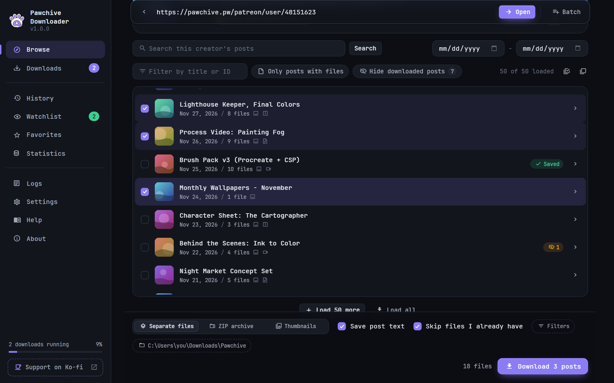
</p>

---

Pawchive Downloader is a desktop app for downloading from Pawchive. Paste a link to a post or a creator, pick exactly what you want, and let a polite, resumable download engine do the rest, in the background, from the tray. It is the big sibling of the [Pawchive Downloader browser extension](https://github.com/VoxDroid/PawchiveDownloader-BrowserExtension) and shares its look, its languages and its rules, with everything a desktop app can add.

**Free to build, official builds on Ko-fi.** The source code is free and MIT licensed: anyone can [build the app](#building-it-yourself). Ready-made, tested installers for Windows, macOS and Linux are offered on [Ko-fi](https://ko-fi.com/izeno); buying one is the easiest way to get the app and keeps the project going.

## Contents

- [Features](#features)
- [Screenshots](#screenshots)
- [Getting the app](#getting-the-app)
- [Using it](#using-it)
- [File names and folders](#file-names-and-folders)
- [Settings](#settings)
- [Privacy and politeness](#privacy-and-politeness)
- [Building it yourself](#building-it-yourself)
- [Development](#development)
- [Project structure](#project-structure)
- [Support the project](#support-the-project)
- [Disclaimer and ethical use](#disclaimer-and-ethical-use)
- [Credits](#credits)
- [License](#license)

## Features

**Downloading**

| Feature                     | What it does                                                                                                                                                                               |
| --------------------------- | ------------------------------------------------------------------------------------------------------------------------------------------------------------------------------------------ |
| Browse                      | Paste or drop a link to a post, a creator or a search. Posts show every file with a thumbnail; creators show their posts with banner and avatar; the recent-posts listing can be searched. |
| Creator search              | Type a name instead of a link to search all of Pawchive's creators (about 100,000), by service, popularity, update date or name. Creator pages show the creator's other accounts.          |
| Image viewer                | Look at a post's images full size with the arrow keys and pick them while you look.                                                                                                        |
| File picking                | Select files or posts by click and Shift-click, filter by type (images, videos, audio, archives, documents, text), invert, hide what you already have.                                     |
| Whole creators              | Download everything, a date range, a site search, or just the posts you tick. Large creators are scanned page by page while downloads already run.                                         |
| Filters                     | Only posts with certain words, skip posts or files with others (plain or `/regex/`), the newest N posts, file types to keep or skip. Defaults in Settings, changeable for each download.   |
| Batch queue and URL import  | Paste any number of links, import a `.txt` file or drag links onto the window. Each creator becomes one download; posts of the same creator are grouped.                                   |
| Three formats               | Separate files in a folder per post, one ZIP archive per post (ZIP64, no size limit, optional parts), or thumbnails only for when the media servers are down.                              |
| Resumable downloads         | Files are written as `.part` files and continue with HTTP Range requests after a pause, a dropped connection or a restart of the app.                                                      |
| Checksums                   | Every finished file is checked against the SHA-256 in its Pawchive address and downloaded again if it does not match.                                                                      |
| Preview-only files          | When Pawchive only keeps a preview, the full file is fetched through the temporary link the post page offers.                                                                              |
| Thumbnail fallback          | If a file's media server keeps failing, its thumbnail can be saved instead of nothing.                                                                                                     |
| Duplicate skipping          | Files are recognised by content hash, across posts and creators, and skipped when you already have them.                                                                                   |
| Post text and metadata      | Save the description as `content.txt` and/or `content.html`, and a `post.json` with title, dates, tags and files.                                                                          |
| Outside links and passwords | Links to Mega, Google Drive, Dropbox and other hosts in a post, plus any archive passwords, are listed on its Links tab and saved to `links.txt`.                                          |
| Comments and announcements  | Save each post's comments with their replies, and a creator's announcements.                                                                                                               |
| Clean names                 | Remove words such as `[HD]` from titles and file names.                                                                                                                                    |
| Fast mode                   | One switch: every file type, your saved options, no per-download choices.                                                                                                                  |

**Managing**

| Feature             | What it does                                                                                                                                                               |
| ------------------- | -------------------------------------------------------------------------------------------------------------------------------------------------------------------------- |
| Download queue      | Pause, resume, cancel, retry and reorder downloads; follow speed, progress and every item, retry single files, open folders.                                               |
| Download window     | Start downloads only at chosen times (for example at night); the computer is kept awake while they run.                                                                    |
| Disk space guard    | New downloads wait instead of failing when the drive is nearly full, and go on by themselves.                                                                              |
| When done           | Quit, sleep or shut down after the queue finishes, with a cancellable countdown. Retry every failed file at once or export the list.                                       |
| Crash-safe          | The queue is saved continuously to a local SQLite library and picks up where it stopped.                                                                                   |
| History             | Every finished download with its files, size, duration and errors. Show it in the folder (or the nearest folder that still exists), download it again, export CSV or JSON. |
| Watchlist           | Follow creators. They are checked on a schedule; new posts raise a badge and a notification and can be downloaded automatically.                                           |
| Per-creator options | Each watched creator can have its own folder, format and filters.                                                                                                          |
| Favorites           | Bookmark posts and creators with notes, download them again in one click, import and export the list as text.                                                              |
| Statistics          | Lifetime totals, the last twelve months, most downloaded creators, files by kind, and a check that finds deleted or moved files and downloads just those again.            |
| Tray and background | Closing the window keeps the app in the tray; progress shows on the tray tooltip and the taskbar button. Optional start at sign-in.                                        |
| Notifications       | Finished downloads, problems and new posts, in your language.                                                                                                              |
| Logs                | A live, searchable activity log with levels, copy and export, also written to a rotating log file.                                                                         |
| Help                | A searchable guide inside the app.                                                                                                                                         |
| Update check        | Looks for a newer version and points to Ko-fi (or the source). It never installs anything by itself.                                                                       |

**Interface**

| Feature        | What it does                                                                                                               |
| -------------- | -------------------------------------------------------------------------------------------------------------------------- |
| Nine languages | English, Japanese, Korean, Simplified Chinese, Spanish, Brazilian Portuguese, Russian, German and French, switchable live. |
| Six themes     | Midnight, Graphite, Plum, Forest, Ember and Light, or Match system, with six accent colors or your own.                    |
| Typography     | JetBrains Mono Nerd Font throughout; every icon comes from the font itself.                                                |
| Motion         | Smooth page and list transitions that respect reduced-motion settings.                                                     |
| Keyboard       | Ctrl+L link bar, Ctrl+Shift+B batch, Ctrl+1 to Ctrl+9 pages, Ctrl+, settings.                                              |
| Network        | System proxy, no proxy, a custom HTTP, HTTPS or SOCKS5 proxy, or Tor; a total speed limit.                                 |

How it compares with other Pawchive and Kemono downloaders: [docs/COMPARISON.md](docs/COMPARISON.md).

## Screenshots

|                                                |                                                               |
| ---------------------------------------------- | ------------------------------------------------------------- |
| 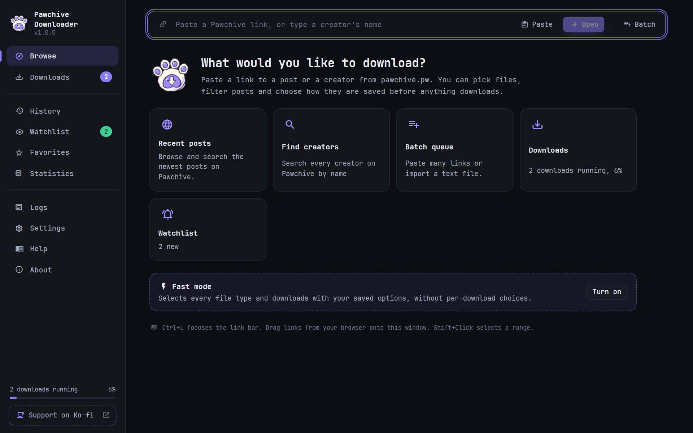     | 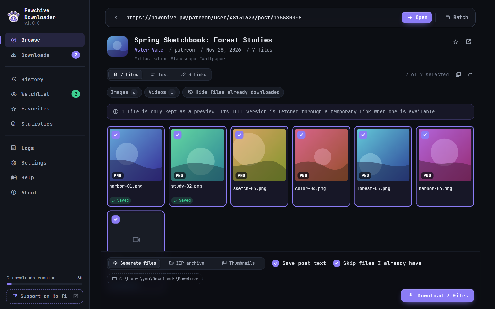           |
| 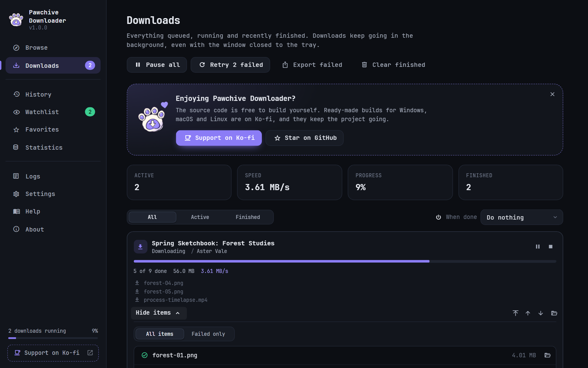   | 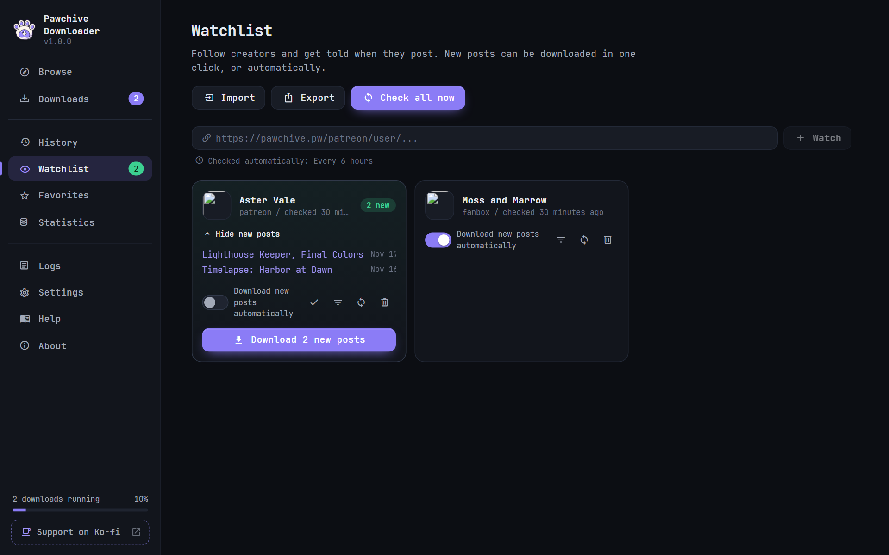                  |
| 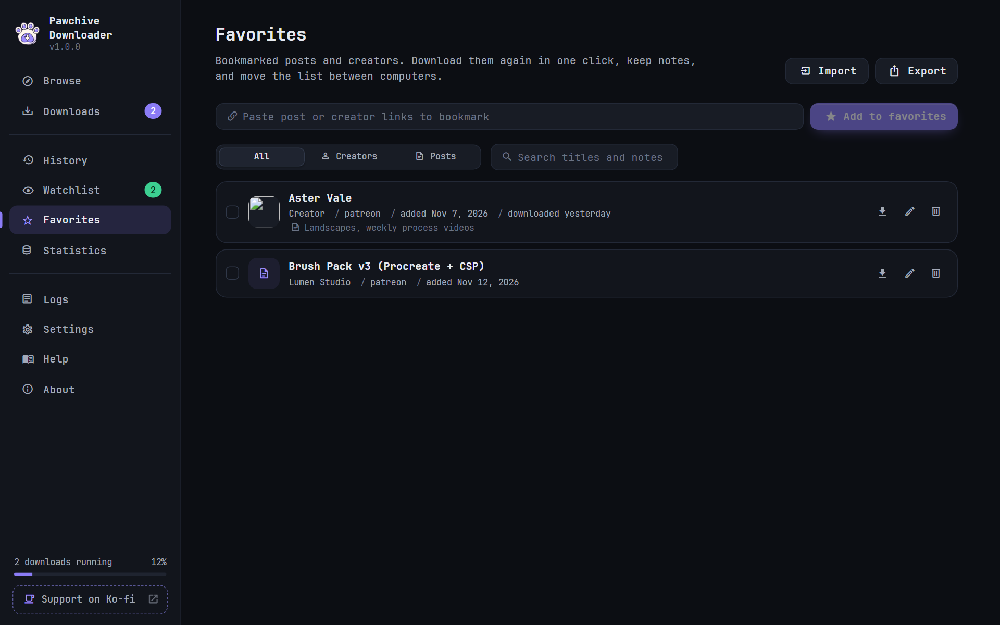   | 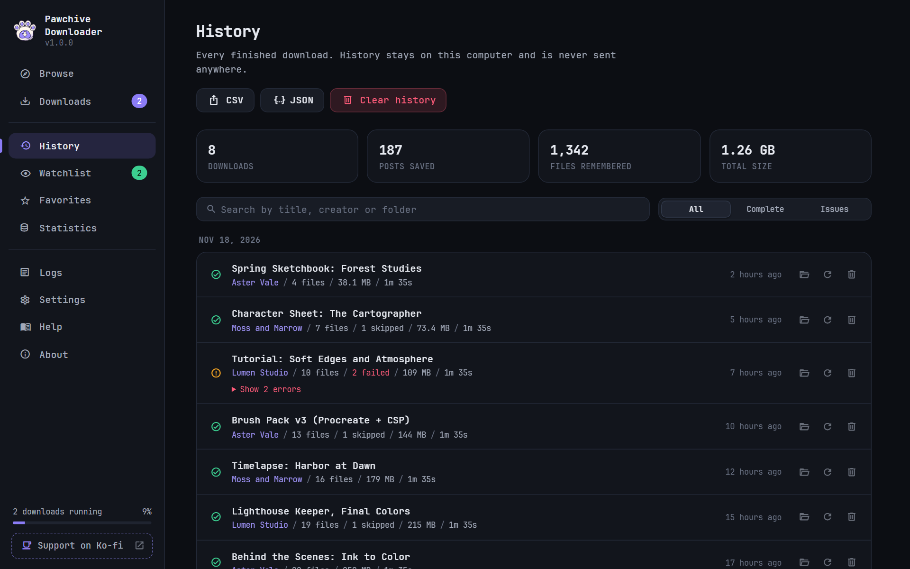                      |
| 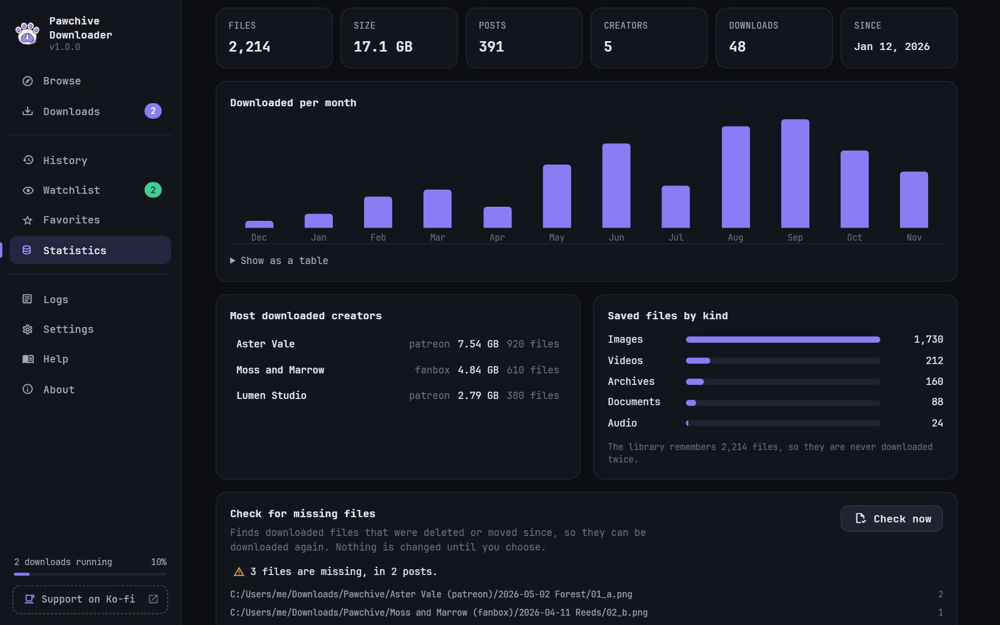 | 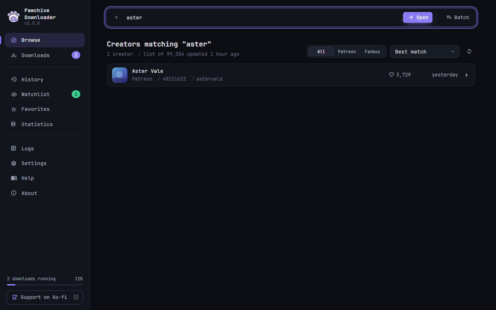                |
| 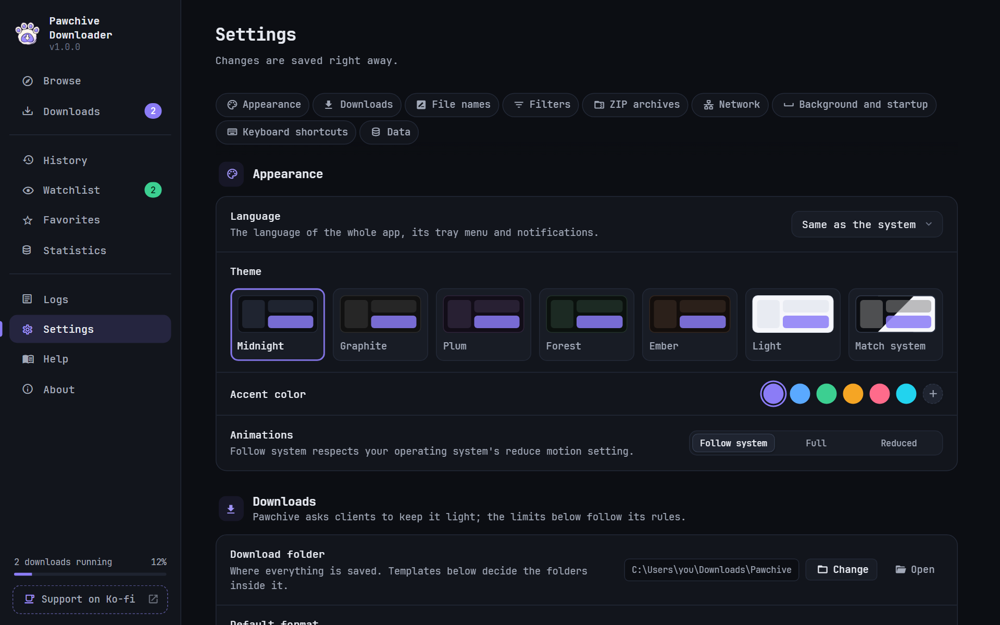     | 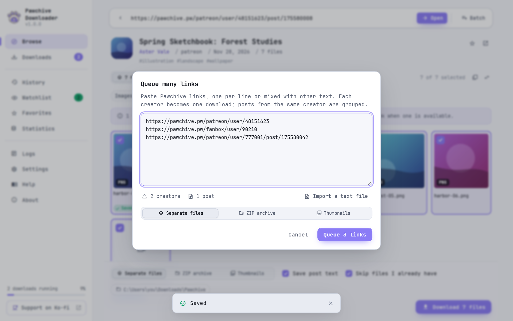 |

The screenshots use the app's demo data.

## Getting the app

- **Official build:** installers for Windows (setup, MSI and portable), macOS (universal DMG for Apple Silicon and Intel) and Linux (AppImage, deb, rpm) are on [Ko-fi](https://ko-fi.com/izeno).
- **Build it yourself:** free, see [below](#building-it-yourself).

The installers are not code-signed yet: Windows SmartScreen and macOS Gatekeeper ask for confirmation the first time. On Windows choose **More info > Run anyway**; on macOS right-click the app and choose **Open**.

On Windows the app uses the Microsoft Edge WebView2 Runtime, which Windows 10 and 11 already include. On Linux it needs WebKitGTK 4.1, which the packages pull in.

## Using it

1. Copy a link from pawchive.pw and paste it into the bar at the top of **Browse** (or press Ctrl+L, or drag the link onto the window).
2. A post opens with its files, a creator with their posts. Pick what you want and filter by type, title or date.
3. In the bar at the bottom choose **Separate files**, **ZIP archive** or **Thumbnails**, whether to save the post text and skip files you have, and where to save. Press **Download**.
4. Follow it in **Downloads**, or close the window: the app keeps working in the tray and tells you when it is done.

To queue many links at once, open **Batch** (Ctrl+Shift+B). To follow a creator, press **Watch** on their page.

## File names and folders

Files go into your download folder, arranged by templates you can change in **Settings > File names** with a live preview:

| Template    | Default                                                                     |
| ----------- | --------------------------------------------------------------------------- |
| Folder      | `Pawchive/{creator} ({service})/{published:YYYY-MM-DD} {title} [{post_id}]` |
| File        | `{index:2}_{filename}`                                                      |
| ZIP archive | `{creator} - {published:YYYY-MM-DD} {title} [{post_id}]`                    |

Tokens: `{service}` `{creator}` `{creator_id}` `{post_id}` `{title}` `{published}` `{added}` `{date}` `{index}` `{count}` `{name}` `{filename}` `{ext}` `{hash}` `{role}`. Dates take a format (`{published:YYYY/MM}`), `{index}` a width (`{index:3}` gives `007`) and `{hash}` a length (`{hash:8}`).

Every value is cleaned so names are valid on Windows, macOS and Linux, cannot hide their real extension and can never point outside the download folder.

## Settings

| Group                  | Settings                                                                                                                                                                                                                                                                             |
| ---------------------- | ------------------------------------------------------------------------------------------------------------------------------------------------------------------------------------------------------------------------------------------------------------------------------------ |
| Appearance             | Language, theme, accent color, animations                                                                                                                                                                                                                                            |
| Downloads              | Download folder, default format, fast mode, simultaneous downloads (up to 5), time between requests (at least 1 s), speed limit, retries, existing files, duplicate skipping, checksum verification, preview-only files, thumbnail fallback, post text, metadata, default file types |
| File names             | Folder, file and ZIP templates                                                                                                                                                                                                                                                       |
| ZIP archives           | Part size or one archive per post, videos beside the archive                                                                                                                                                                                                                         |
| Network                | Proxy (system, none, custom, Tor), proxy address                                                                                                                                                                                                                                     |
| Background and startup | Keep running in the tray, start at sign-in, start in the tray, notifications, watchlist interval, update check, history, log detail                                                                                                                                                  |
| Data                   | Back up and restore settings, open the data folder, forget remembered files, reset                                                                                                                                                                                                   |

## Privacy and politeness

No accounts, analytics or tracking. Settings, history, the watchlist, favorites and logs stay in the app's folder on your computer (`library.db`); the app only connects to Pawchive and, if you leave the update check on, to GitHub. See [PRIVACY.md](PRIVACY.md).

Pawchive asks clients for at most five downloads at once and one new request per second. The app enforces both, identifies itself with its own user agent and a contact address as the site asks, and when Pawchive answers 429 (or 503 with Retry-After) every request waits as long as the site says.

## Building it yourself

You need [Node.js](https://nodejs.org) 20 or newer, [pnpm](https://pnpm.io) 10, and [Rust](https://rustup.rs) (stable). Follow the [Tauri prerequisites](https://tauri.app/start/prerequisites/) for your system (on Linux: WebKitGTK 4.1 and a few libraries).

```bash
git clone https://github.com/VoxDroid/PawchiveDownloader.git
cd PawchiveDownloader
pnpm install
pnpm tauri build
```

The installers land in `src-tauri/target/release/bundle/`, the program itself in `src-tauri/target/release/`. Builds made from source call themselves **Built from source** on the About page.

## Development

```bash
pnpm install
pnpm app:dev        # run the app with hot reload
pnpm dev            # only the interface, in a browser, on demo data
pnpm check          # lint, format, types, translations, interface tests
pnpm test:rust      # Rust unit and integration tests
pnpm test:e2e       # interface tests in a browser (Playwright)
pnpm screenshots    # README screenshots from the demo data
pnpm icons          # render the icon with Blender
```

See [CONTRIBUTING.md](CONTRIBUTING.md), [docs/ARCHITECTURE.md](docs/ARCHITECTURE.md) and [docs/TRANSLATING.md](docs/TRANSLATING.md).

## Project structure

```
src-tauri/            Rust: the app and its download engine
  src/pawchive/       API client, URLs, normalizing, relay links
  src/net/            HTTP client, rate limiter, speed limit
  src/naming/         templates and safe file names
  src/jobs/           job model, planning, engine, transfers, ZIP
  src/store/          SQLite library: queue, history, hashes, watchlist, favorites
  src/watch.rs        scheduled watchlist checks
  src/app.rs          window, tray, notifications, live updates
  src/commands.rs     what the interface can call
  tests/              integration tests against a mock Pawchive
src/                  Svelte 5 interface
  features/           Browse, Downloads, History, Watchlist, Favorites, Logs, Settings, Help, About
  ui/                 components, layout, theme, state
  lib/                bridge to Rust, demo backend, translations, helpers
tests/                Vitest unit and component tests, Playwright UI tests
scripts/              font subsetting, icon rendering, translations, screenshots
docs/                 architecture, extension bridge, translating, screenshots
```

## Support the project

Pawchive Downloader is free to build. If it saves you time, the [official build on Ko-fi](https://ko-fi.com/izeno) is the simplest way to get it and to support its development. Starring the repository helps too.

## Disclaimer and ethical use

This project is not affiliated with Pawchive. Creators rely on their supporters: download only what you have the right to, keep it for personal use, and support the creators you enjoy on their own pages. You are responsible for how you use the app and for following the laws where you live.

## Credits

- [JetBrains Mono](https://www.jetbrains.com/lp/mono/) and [Nerd Fonts](https://www.nerdfonts.com) (SIL Open Font License 1.1)
- Built with [Tauri](https://tauri.app), [Rust](https://www.rust-lang.org) and [Svelte](https://svelte.dev)
- The download policy follows [KemonoDownloader](https://github.com/VoxDroid/KemonoDownloader)
- Hand-drawn icon rendered with [Blender](https://www.blender.org)

## License

[MIT](LICENSE) © VoxDroid
